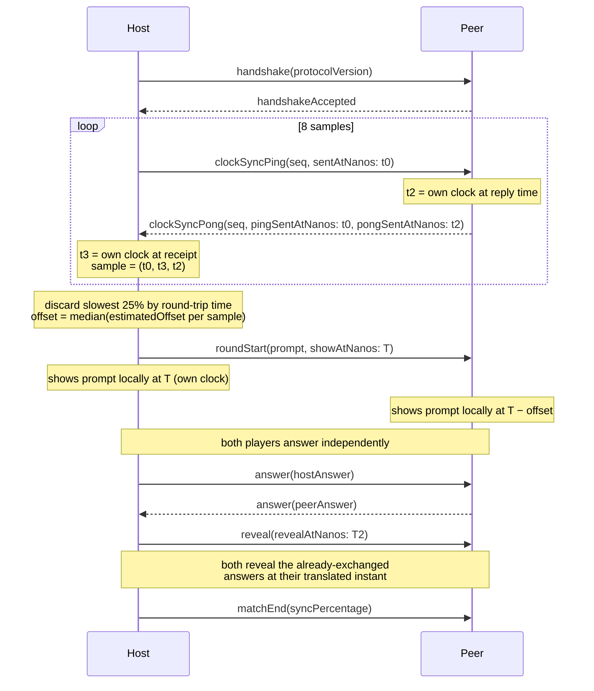
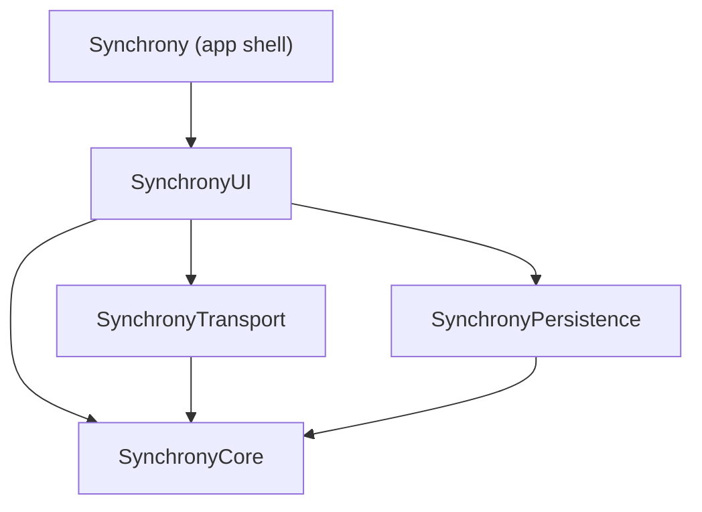

# Synchrony

A cooperative two-player game for iPhone: no server, no accounts, no internet. Two devices discover each other over the local network and play a round of shared prompts, answering in secret and revealing at the same instant.

> 🚧 Work in progress. This README will grow with each phase — see [Project status](#project-status) below.

## Project status

**Phase 6 — Real transport.** `MultipeerTransport` implements `GameTransport` over MultipeerConnectivity with zero-config pairing (one device hosts, the other joins — no picker UI), and `ClockOffsetEstimator` turns ping/pong samples into a clock offset with outlier rejection. See [ADR-0004](docs/adr/0004-clock-synchronization-mechanism.md) for the full mechanism and its sequence diagram.

## Simultaneous synchronization



Full rationale in [ADR-0004](docs/adr/0004-clock-synchronization-mechanism.md).

See [CONTRIBUTING.md](CONTRIBUTING.md) for the branching model, commit convention, and how to run tests, lint, and format locally.

## Architecture



- **SynchronyCore** — domain models, game engine, match state machine. No UIKit/SwiftUI/MultipeerConnectivity imports; pure and fully testable.
- **SynchronyTransport** — the `GameTransport` protocol plus a real `MultipeerTransport` and an `InMemoryTransport` for tests and previews.
- **SynchronyPersistence** — SwiftData models and repository for local match history.
- **SynchronyUI** — SwiftUI views and view models.
- **Synchrony (app target)** — composition root, entry point, Info.plist, assets.

Architecture decisions are recorded in [`docs/adr/`](docs/adr):

- [0001 — Record architecture decisions](docs/adr/0001-record-architecture-decisions.md)
- [0002 — One local SPM package with four targets](docs/adr/0002-local-spm-package-structure.md)
- [0003 — Closed enum for PromptKind](docs/adr/0003-prompt-kind-closed-enum.md)
- [0004 — Clock synchronization mechanism](docs/adr/0004-clock-synchronization-mechanism.md)

## Building

Requirements: Xcode 16.4+, iOS 17.0 simulator or device.

```bash
git clone https://github.com/joacochifte/synchrony.git
cd synchrony
open Synchrony.xcodeproj
```

Select the `Synchrony` scheme and run on an iPhone simulator (⌘R). No manual configuration steps.

To run the package's own test suite directly:

```bash
swift test --package-path Packages/Synchrony
```

## Known limitations

- No UI yet — nothing to play by hand until Phase 8.
- `MultipeerTransport` compiles and is exercised by real device testing, but MultipeerConnectivity peer discovery needs two physical devices (or a device + simulator, with caveats); this can't run in CI, which is why `ClockOffsetEstimator` — the one piece of the sync mechanism that's pure math — is what's actually unit tested, with synthetic samples.
- The coordinator that runs the clock-sync ping/pong exchange over a live match and schedules real local events from it doesn't exist yet; it arrives once the UI needs to drive an actual match (Phase 8). See ADR-0004.
- Building against MultipeerConnectivity emits Swift 6 concurrency warnings from Apple's own (not-yet-Sendable-audited) SDK, silenced at the import boundary with `@preconcurrency` — expected, not a bug in this code.

## License

[MIT](LICENSE)
