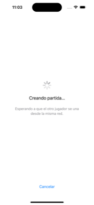
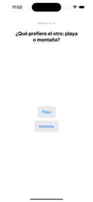
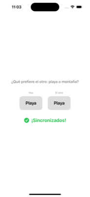
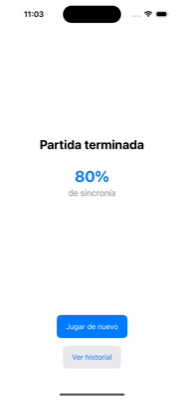
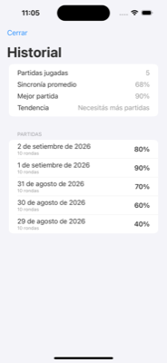
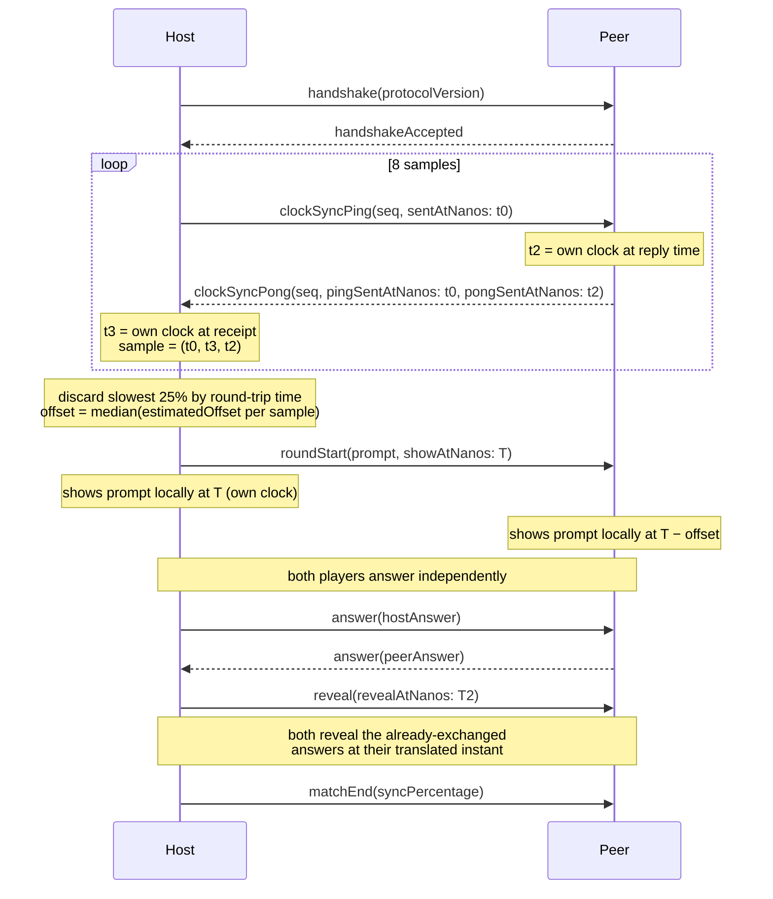
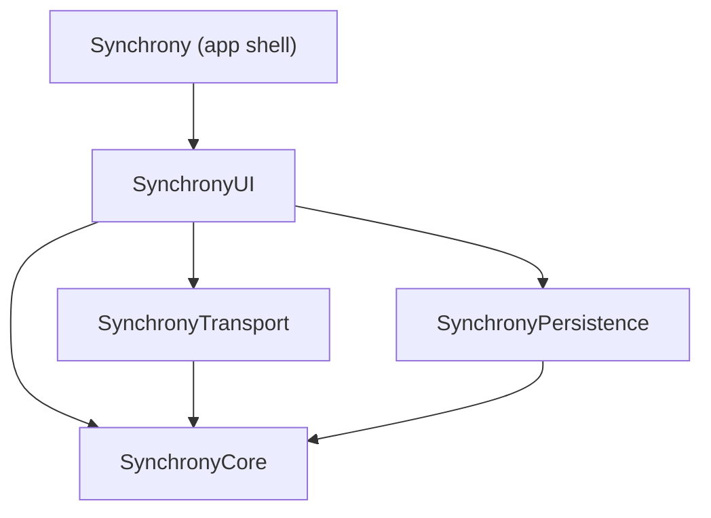

# Synchrony

[](https://github.com/joacochifte/synchrony/actions/workflows/ci.yml)
[](https://swift.org)
[](https://developer.apple.com/ios/)
[](LICENSE)

A cooperative two-player game for iPhone: no server, no accounts, no internet. Two devices discover each other over the local network and play a round of shared prompts, answering in secret and revealing at the same instant.

<p align="center">
  
  
  
  
  
</p>

## Project status

**Phase 10 — Done.** All ten phases complete: scaffolding, tooling, domain model, game engine, transport abstraction, real MultipeerConnectivity transport, persistence, UI, polish, and this final documentation pass. Tagged `v1.0.0`.

## Simultaneous synchronization



Full rationale in [ADR-0004](docs/adr/0004-clock-synchronization-mechanism.md).

See [CONTRIBUTING.md](CONTRIBUTING.md) for the branching model, commit convention, and how to run tests, lint, and format locally.

## Architecture



- **SynchronyCore** — domain models, game engine, match state machine. No UIKit/SwiftUI/MultipeerConnectivity imports; pure and fully testable.
- **SynchronyTransport** — the `GameTransport` protocol plus a real `MultipeerTransport` and an `InMemoryTransport` for tests and previews.
- **SynchronyPersistence** — SwiftData models and repository for local match history.
- **SynchronyUI** — SwiftUI views and view models.
- **Synchrony (app target)** — composition root, entry point, Info.plist, assets.

Architecture decisions are recorded in [`docs/adr/`](docs/adr):

- [0001 — Record architecture decisions](docs/adr/0001-record-architecture-decisions.md)
- [0002 — One local SPM package with four targets](docs/adr/0002-local-spm-package-structure.md)
- [0003 — Closed enum for PromptKind](docs/adr/0003-prompt-kind-closed-enum.md)
- [0004 — Clock synchronization mechanism](docs/adr/0004-clock-synchronization-mechanism.md)
- [0005 — SwiftData over Core Data](docs/adr/0005-swiftdata-over-core-data.md)
- [0006 — MultipeerConnectivity for peer-to-peer transport](docs/adr/0006-multipeer-connectivity.md)
- [0007 — GameTransport as the only network abstraction](docs/adr/0007-game-transport-abstraction.md)
- [0008 — JSONEncoder over PropertyListEncoder](docs/adr/0008-json-message-encoding.md)

The wire protocol itself — every `GameMessage` case, a table of fields, and out-of-order/error handling — is specified in [`docs/PROTOCOL.md`](docs/PROTOCOL.md).

## Building

Requirements: Xcode 16.4+, iOS 17.0 simulator or device.

```bash
git clone https://github.com/joacochifte/synchrony.git
cd synchrony
open Synchrony.xcodeproj
```

Select the `Synchrony` scheme and run on an iPhone simulator (⌘R). No manual configuration steps.

To run the package's own test suite directly:

```bash
swift test --package-path Packages/Synchrony
```

## Known limitations

- `MultipeerTransport` compiles and is exercised by `GameCoordinator`'s full-match test over `InMemoryTransport`, but real MultipeerConnectivity peer discovery needs two physical devices (or a device + simulator, with caveats); this can't run in CI, which is why `ClockOffsetEstimator` — the one piece of the sync mechanism that's pure math — is what's actually unit tested, with synthetic samples.
- Direction prompts use a plain 0–359° slider rather than a real compass reading — CoreLocation sensing is device-only and can't be exercised in a preview or CI, and wiring it in doesn't change anything about the domain layer or protocol.
- Building against MultipeerConnectivity emits Swift 6 concurrency warnings from Apple's own (not-yet-Sendable-audited) SDK, silenced at the import boundary with `@preconcurrency` — expected, not a bug in this code.
- `Info.plist`'s permission strings (local network, compass) are Spanish-only — those live in a separate catalog (`InfoPlist.xcstrings`) from the app's own UI strings, and localizing them wasn't worth the added scope this phase. An English-locale user sees Spanish permission prompts.
- Localized strings with plural counts (e.g. "%lld rondas") use a single fixed form rather than real plural rules — acceptable for Spanish, less correct for English's singular/plural split at exactly one round.
- At the largest accessibility text size, the two buttons on the home screen truncate their labels with "…" instead of wrapping to a second line — readable and tappable, not a broken layout, just not the ideal presentation at that extreme.
- No test coverage badge: CI generates a real per-file coverage report (`xcrun llvm-cov`) and uploads it as a build artifact, but a live-updating badge needs an external service (Codecov, or a Gist-based dynamic badge) wired up with an account token — that's a one-time setup only the repo owner can do, not something to fake with a static number that goes stale the moment it's committed.
- The CI badge above only turns green after this repository is pushed to GitHub and the workflow runs at least once — it's wired to the real workflow, just not yet exercised.

## License

[MIT](LICENSE)
