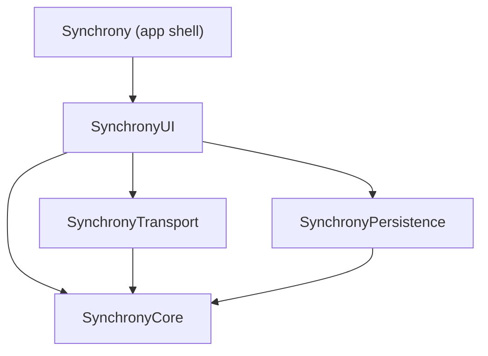

# Synchrony

A cooperative two-player game for iPhone: no server, no accounts, no internet. Two devices discover each other over the local network and play a round of shared prompts, answering in secret and revealing at the same instant.

> 🚧 Work in progress. This README will grow with each phase — see [Project status](#project-status) below.

## Project status

**Phase 1 — Scaffolding.** The repository structure, Xcode project, and local Swift package are in place. No gameplay logic yet.

## Architecture



- **SynchronyCore** — domain models, game engine, match state machine. No UIKit/SwiftUI/MultipeerConnectivity imports; pure and fully testable.
- **SynchronyTransport** — the `GameTransport` protocol plus a real `MultipeerTransport` and an `InMemoryTransport` for tests and previews.
- **SynchronyPersistence** — SwiftData models and repository for local match history.
- **SynchronyUI** — SwiftUI views and view models.
- **Synchrony (app target)** — composition root, entry point, Info.plist, assets.

Architecture decisions are recorded in [`docs/adr/`](docs/adr):

- [0001 — Record architecture decisions](docs/adr/0001-record-architecture-decisions.md)
- [0002 — One local SPM package with four targets](docs/adr/0002-local-spm-package-structure.md)

## Building

Requirements: Xcode 16.4+, iOS 17.0 simulator or device.

```bash
git clone https://github.com/joacochifte/synchrony.git
cd synchrony
open Synchrony.xcodeproj
```

Select the `Synchrony` scheme and run on an iPhone simulator (⌘R). No manual configuration steps.

To run the package's own test suite directly:

```bash
swift test --package-path Packages/Synchrony
```

## Known limitations

- No gameplay yet — this phase only sets up the project structure.
- MultipeerConnectivity requires two physical devices (or a device + simulator, with caveats) to test peer discovery; this can't run in CI.

## License

[MIT](LICENSE)
