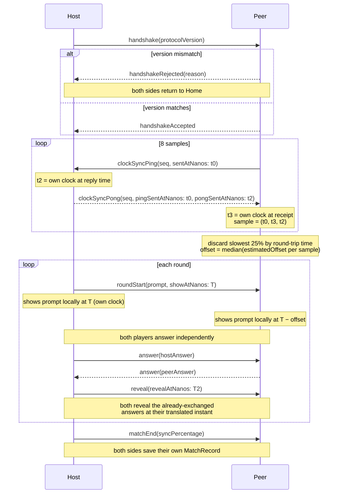

# Synchrony wire protocol

Everything that crosses a `GameTransport` is a `GameMessage` (defined in [`Packages/Synchrony/Sources/SynchronyTransport/GameMessage.swift`](../Packages/Synchrony/Sources/SynchronyTransport/GameMessage.swift)), encoded with `JSONEncoder` — see [ADR-0008](adr/0008-json-message-encoding.md) for why JSON over a binary plist. Host and peer are not symmetric: the host initiates the handshake, owns the authoritative `MatchEngine`, and decides round timing; the peer reacts to whatever it receives. See [ADR-0007](adr/0007-game-transport-abstraction.md) for the transport abstraction this rides on, and [ADR-0004](adr/0004-clock-synchronization-mechanism.md) for the full clock-sync mechanism the ping/pong and scheduled-instant messages implement.

## Protocol version

`ProtocolVersion.current` is a plain `Int`, bumped on any breaking change to `GameMessage`'s shape. It's checked once, in the handshake — a mismatch means an old and a new build of the app trying to play together, which fails loudly rather than silently misbehaving.

## Message table

| Case | Fields | Sent by | Purpose |
|---|---|---|---|
| `handshake` | `protocolVersion: Int` | Host, once connected | Declares the protocol version the host speaks. |
| `handshakeAccepted` | — | Peer | Confirms a matching protocol version; the host starts the match on receiving this. |
| `handshakeRejected` | `reason: String` | Peer | Protocol versions don't match. `reason` is a technical, non-localized detail — the two devices aren't guaranteed to share a locale, so the receiving side shows its own localized message rather than the raw string (see `GameCoordinator.handleHandshakeRejected`). |
| `clockSyncPing` | `sequence: Int`, `sentAtNanos: Int64` | Peer, 8 times per sync round | One round-trip sample. `sentAtNanos` is the peer's own `ContinuousClock` reading relative to a private origin instant — never `Date`. |
| `clockSyncPong` | `sequence: Int`, `pingSentAtNanos: Int64`, `pongSentAtNanos: Int64` | Host, echoing each ping | `pingSentAtNanos` is echoed back unchanged; `pongSentAtNanos` is the host's own clock at reply time. Together with the peer's own send/receive timestamps, this becomes one `ClockSyncSample`. |
| `roundStart` | `prompt: Prompt`, `showAtNanos: Int64` | Host, once per round | Carries the round's prompt and a future instant (host's clock) at which to show it. Each device — host included — translates `showAtNanos` through its own offset estimate and schedules the prompt locally; nothing reacts to this message's *arrival* as the trigger. |
| `answer` | `AnswerValue` | Both, once each per round | The sender's answer to the current round's prompt. |
| `reveal` | `revealAtNanos: Int64` | Host, once both answers are in | Same scheduling pattern as `roundStart`: a future instant, translated locally, not an immediate trigger. |
| `matchEnd` | `syncPercentage: Double` | Host, after the last round | Final score for the match, computed by the host's `MatchEngine`. |

## Handling out-of-order and wrong-state messages

- **Version mismatch**: rejected explicitly at handshake (`handshakeRejected`), never silently accepted.
- **Wrong protocol state**: `MatchEngine.submitAnswer`/`.advance()` throw `MatchEngineError` when called outside their expected state (e.g. two answers arriving before a round has started). `GameCoordinator` calls these with `try?` — a message that doesn't fit the current state is dropped, not fatal.
- **Malformed data**: `MultipeerTransport` drops anything that fails to decode as a `GameMessage` rather than crashing the session (`handleReceivedData`).
- **Peer disconnects mid-match**: surfaced through `GameTransport.connectionState`'s `.disconnected(reason:)` case, observed by `GameCoordinator.observeConnectionState`, which shows an error and returns to the home screen rather than hanging.

## Sequence diagram

