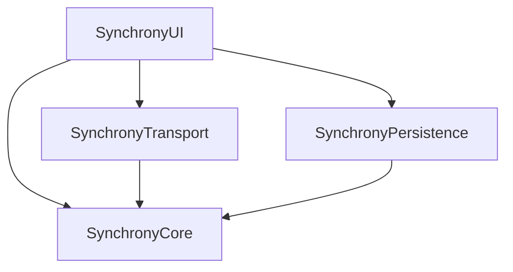

# 2. One local Swift package with four targets, not four separate packages

## Status

Accepted

## Context and Problem Statement

Synchrony's engine needs to be fully testable without MultipeerConnectivity, UIKit, or SwiftUI in the picture, which calls for splitting the code into layers with an enforced dependency direction: domain and game engine at the bottom, transport and persistence in the middle, UI at the top. Swift Package Manager can express that boundary either as one local package with several targets, or as several independent local packages.

## Decision Drivers

- The dependency direction (`SynchronyCore` at the bottom, `SynchronyUI` at the top) has to be enforced by the build, not by convention.
- A single `swift test` invocation should exercise the whole graph, both locally and in CI.
- None of these modules are meant to be versioned, released, or consumed outside this app.

## Considered Options

- Four independent local Swift packages (`SynchronyCore`, `SynchronyTransport`, `SynchronyPersistence`, `SynchronyUI`), each with its own `Package.swift`, referenced from the app as separate local package dependencies.
- One local package (`Packages/Synchrony`) with four library targets and four matching test targets, sharing a single manifest.

## Decision Outcome

Chosen option: "one local package with four targets", because a `target` boundary in SPM is enforced exactly as strictly as a `package` boundary — an `import` of a target you did not declare as a dependency fails to compile either way. Four separate packages would mean four manifests to keep in sync and four dependency graphs to resolve, with no corresponding benefit: none of these modules is versioned or consumed outside this repository. One manifest, one `Package.resolved`, one `swift test` covering `SynchronyCoreTests`, `SynchronyTransportTests`, `SynchronyPersistenceTests`, and `SynchronyUITests` together.

Dependency direction:

`SynchronyCore` depends on nothing else in the graph and imports no platform framework — it is the layer required to be pure and 100% testable via `InMemoryTransport`, per the project's core technical requirement.

If any of these targets ever needs independent versioning or reuse outside this app, that is grounds to split it into its own package — this decision is not meant to be permanent, just the right default for a single-app monorepo.
