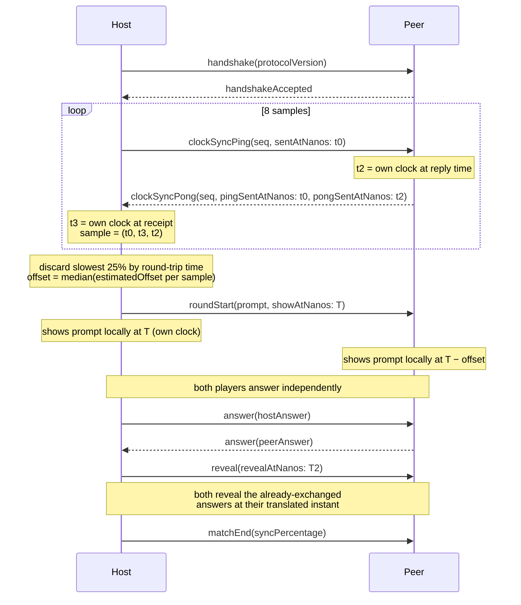

# 4. Clock synchronization mechanism

## Status

Accepted

## Context and Problem Statement

The core promise of the game is that both players see the same prompt "at the same instant." Over a real P2P link, latency is variable and asymmetric — "host tells peer to show the prompt now" arrives at a different, unpredictable delay each time. Naively showing the prompt on `didReceive` gives each device a different, jittery start time, which breaks the game's central conceit.

There's no shared server and no NTP-style external time authority: this is two iPhones talking directly over MultipeerConnectivity. Each device only has its own monotonic clock (`ContinuousClock`), which drifts from the other's by an unknown amount that has to be estimated from the connection itself.

## Decision Drivers

- Never use `Date`: it can jump (system NTP sync, DST, the user changing the clock manually) mid-match, which would corrupt any offset estimate built on it.
- The estimation has to tolerate a jittery Wi-Fi/Bluetooth link without a full four-timestamp NTP exchange, since `GameMessage`'s pong only carries the peer's send-time, not its receive-time (see `ClockOffsetEstimator`).
- A single bad sample (a latency spike) shouldn't skew the whole estimate.
- The UI needs a signal when the connection is too unstable to trust the estimate, so it can widen its margin or tell the player the link is degraded.

## Considered Options

- **Show-on-receive**: the host sends "show now," the peer displays the prompt the instant the message arrives. Simplest possible implementation, but the peer's display time drifts by however long the message took to arrive — exactly the jitter this feature exists to eliminate.
- **Full four-timestamp NTP exchange**: ping carries the sender's send-time; pong carries both the peer's receive-time and its own send-time; the client computes offset from all four timestamps, canceling out asymmetric latency. Textbook-correct, but requires widening `GameMessage.clockSyncPong` to carry an extra timestamp for a P2P link where latency is close enough to symmetric that the extra precision isn't worth the added protocol surface.
- **Symmetric-latency round-trip estimation + scheduled future events**: measure round-trip time over several ping/pong samples, assume the ping and pong each took half of it, and estimate the offset from that. Schedule prompt reveals at a future instant on the *host's* clock, which each device translates into its own clock using the estimated offset — rather than reacting to "now" messages.

## Decision Outcome

Chosen option: "symmetric-latency round-trip estimation + scheduled future events." On a local Wi-Fi/Bluetooth P2P link, ping and pong latency are close enough to symmetric that the simplifying assumption holds well in practice, and it keeps the wire protocol smaller than a full NTP exchange would.

**Sampling.** Before each round, the host sends several `clockSyncPing` messages, each with a sequence number and its own `ContinuousClock` send-time (`sentAtNanos`). The peer echoes each one back as `clockSyncPong` with that same send-time and its own `ContinuousClock` time when it replied (`pongSentAtNanos`). The host measures its own round-trip time locally (`ContinuousClock` again — never `Date`) and turns each exchange into a `ClockSyncSample`.

**Estimation.** `ClockOffsetEstimator.estimateOffsetNanos(from:)` sorts samples by round-trip time, discards the slowest 25% (the least trustworthy — latency spikes distort the symmetric-latency assumption the most), and takes the median offset of what's left. Median over mean, because one bad sample should be outvoted, not averaged in.

**Scheduling.** Instead of "show this now," the host sends `roundStart(prompt:showAtNanos:)` with a timestamp far enough in the future to cover expected latency (the spec's own example: now + 500ms). Each device — including the host itself — translates `showAtNanos` through its own offset estimate and schedules the prompt to appear locally at that translated instant. `reveal(revealAtNanos:)` works the same way once both answers are in. Neither device ever acts on message *arrival* as the trigger; arrival only ever schedules a future local event.

**Degradation.** `ClockOffsetEstimator.roundTripVarianceNanos(of:)` gives a cheap jitter signal; `ConnectionQuality.classify(roundTripVarianceNanos:)` flags the link as `.degraded` above a 50ms² variance threshold (~7ms standard deviation — generous, since P2P jitter on iOS commonly sits in the low milliseconds even on a healthy link). A degraded classification is meant to both show a connection-quality indicator in the UI and widen the scheduling margin (e.g. 500ms → 1000ms) — the actual wiring of that policy into a live match happens once the UI needs it, alongside `ClockOffsetEstimator`.

## What this doesn't cover

`ClockOffsetEstimator` is pure, deterministic, and fully unit-tested with synthetic samples — that's the piece this ADR is confident is correct. The coordinator that actually runs this exchange over a live `GameTransport` mid-match, applies the resulting offset to schedule real `Task.sleep`-driven local events, and reacts to `ConnectionQuality` by widening the margin doesn't exist yet; per ADR-0002's precedent, that composition point is built once the UI layer needs to drive a real match, not speculatively ahead of a caller.
